# Auditoría de diseño: SOLID y patrones HotelUQ

Complemento de [auditoria-proyecto-final.md](auditoria-proyecto-final.md), basado en el PDF oficial §5, §6 y §8. La auditoría original describe código existente y propuestas separadas. La actualización de Strategy documenta el cierre funcional posterior de H-01, con 272 pruebas; el resto del diseño se mantiene como auditado. Los diagramas Mermaid son documentación de auditoría, **no el diagrama de clases PDF de entrega**.

Rutas de código desde esta carpeta: `../src/main/java/edu/hoteluq/`; pruebas: `../src/test/java/edu/hoteluq/`. Las referencias apuntan al árbol local auditado, que incluye cambios previos sin commit.

## 1. Cinco principios SOLID: evaluación verificable

| Principio / estado | Problema y solución concreta observada | Clases y evidencia | Evidencia de funcionamiento | Límite o mejora necesaria |
|---|---|---|---|---|
| SRP — PARCIAL | Separar reglas de dinero, conversión temporal y construcción de productos evita duplicar ese detalle en cada servicio. | [CopMoney](../src/main/java/edu/hoteluq/money/CopMoney.java), [HotelTime](../src/main/java/edu/hoteluq/config/HotelTime.java), fábricas concretas y records de BookingRecords. | CommercialPolicyValidationTest; Commercial3BTest.dayMonthAndYearBoundariesUseBogotaForMovementsAndOperations; HotelTest.singletonAndFactoryRemainFunctionalForAllCategories. | [Hotel](../src/main/java/edu/hoteluq/singleton/Hotel.java) tiene 736 líneas y concentra identidad, sesiones, autorización, catálogos, unicidad/referencias, políticas, reservas, transacciones y auditoría: múltiples motivos de cambio. Reservar la coordinación atómica a una unidad de trabajo y extraer responsabilidades cohesivas cuando se refactorice; no partir el bloqueo y romper invariantes. |
| OCP — PARCIAL | Variar creación de habitaciones o cálculo de devolución mediante polimorfismo reduce condicionales en el cliente. | [RoomCreator](../src/main/java/edu/hoteluq/factory/RoomCreator.java) y subclases; [RefundPolicy](../src/main/java/edu/hoteluq/strategy/RefundPolicy.java), Full/Partial/No/ConfiguredRefundPolicy; ReservationState. | Fábricas para todas las categorías; Strategy en pruebas de límites/reembolso; State en confirmación/cancelación/check-out. | RoomCreatorRegistry/RoomCategory requieren edición para otra categoría; Hotel selecciona FullRefundPolicy/concreto CancellationSchedule y hace cast a ConfiguredRefundPolicy para percent. El agregado conoce detalles concretos de selección. Tras H-01, las tasas oficiales están intencionalmente cerradas a cambios comerciales; el punto de variación permitido es la representación técnica equivalente, no alterar la norma. No es necesario inventar categorías infinitas: documentar el punto de extensión que realmente se necesita. |
| LSP — PARCIAL | Tratar Standard/Family/Suite como Room permite consultas comunes con contratos coherentes. Las políticas concretas implementan el cálculo del mismo concepto. | [Room](../src/main/java/edu/hoteluq/model/Room.java), tres subclases, [RoomCreatorRegistry](../src/main/java/edu/hoteluq/factory/RoomCreatorRegistry.java); implementaciones RefundPolicy. | HotelTest.singletonAndFactoryRemainFunctionalForAllCategories y CatalogValidationTest; pruebas de límites y devoluciones reales. | No hay suite de contratos de sustitución completa para todos los subtipos. RefundPolicy obliga double pero da una implementación decimal por defecto que lanza UnsupportedOperationException: una nueva política que solo cumpla la parte abstracta podría fallar al usarse donde se espera cálculo exacto. Es un riesgo de contrato/extensión, no un fallo demostrado de las cuatro implementaciones actuales. Validar categorías en constructores no prueba por sí solo violación LSP; rechazar una transición no permitida por State tampoco. |
| ISP — PARCIAL | ManagedEntity necesita solo autorizar mutación y lectura; separar esa política evita una dependencia sobre una fachada enorme. | [EntityGuard](../src/main/java/edu/hoteluq/security/EntityGuard.java) expone `mutate/read`; [ManagedEntity](../src/main/java/edu/hoteluq/security/ManagedEntity.java) usa ambos; RefundPolicy tiene cálculo/nombre. | UserAuthorizationTest.directBusinessAndEntityCallsCannotBypassFacadePermissions y pruebas de scopes/concurrencia. | Guard es pequeño y cohesivo. RefundPolicy mezcla legado double y contrato decimal; separar el adaptador legado del puerto exacto facilitaría consumidores. ReservationState presenta operaciones comunes y rechazos por estado como parte del protocolo, no se declara infracción ISP solo porque un terminal no pague. No dividir interfaces para aumentar cantidades. |
| DIP — PARCIAL | Inyectar Clock hace fechas reproducibles; depender de EntityGuard/RefundPolicy permite separar detalles de acceso/cálculo. | Constructor package-private [Hotel(Clock, Duration)](../src/main/java/edu/hoteluq/singleton/Hotel.java#L57), EntityGuard y RefundPolicy. | Phase2Fixture.MutableClock, AuthenticationSessionTest.sessionExpiresAtTheExactConfiguredInstant y Commercial3BTest; modelos protegidos con guardas reales. | Las fachadas se acoplan a Hotel concreto; RoomCreator tiene fallback al Singleton; Hotel importa Views/BookingRequest/BookingRules de service y BookingRecords.Checkout referencia BookingRules.CheckoutWindow. La inyección de un Hotel concreto permite elegir instancia, pero no acredita por sí sola inversión de dependencias. Proponer puertos mínimos y contratos de dominio separados de DTO de aplicación, manteniendo una frontera transaccional única. |

Los cinco tienen ejemplos parciales, no una certificación global. Las pruebas funcionales no prueban formalmente SOLID: sirven como evidencia del comportamiento que el diseño permite y como protección al refactorizar. Para sustentación hay que recorrer un problema, solución, clase/método y consecuencia, incluyendo estos límites.

## 2. Inventario de patrones inequívocos

Conteo por patrones distintos, no por cantidad de clases ni instancias: **3 creacionales, 4 estructurales y 2 de comportamiento GoF**, más Specification como patrón de dominio. Los diagramas siguientes solo representan participantes presentes.

### 2.1 Singleton — creacional — implementado

**Problema:** compartir un agregado en memoria en el arranque normal sin crear instancias globales concurrentes incompatibles. **Participantes:** Hotel, clase interna Holder y consumidores por `getInstance()`.

**Evidencia:** [Hotel.Holder/getInstance](../src/main/java/edu/hoteluq/singleton/Hotel.java#L24); inicialización estática del holder; constructor normal privado. Hay constructor package-private para pruebas con reloj/instancia aislada: el patrón corresponde al acceso productivo por defecto, no a afirmar que ninguna prueba puede construir otro agregado.

**Prueba:** HotelTest.singletonAndFactoryRemainFunctionalForAllCategories usa `assertSame(hotel, Hotel.getInstance())`. Pruebas de concurrencia ejercitan ese agregado/instancias aisladas. El holder no sustituye la sincronización de operaciones: esta la implementa Hotel por separado.

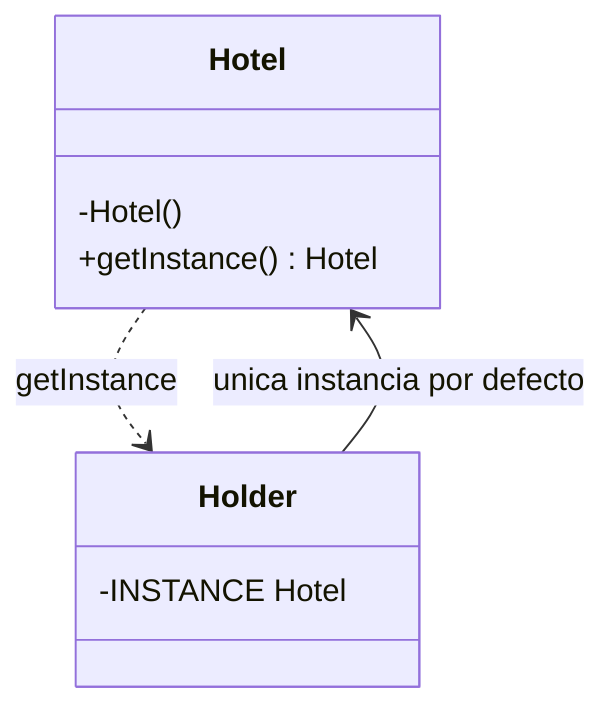

### 2.2 Factory Method — creacional — implementado

**Problema:** construir una habitación de categoría coherente sin dispersar `new StandardRoom/FamilyRoom/SuiteRoom` en la fachada. **Participantes:** RoomCreator, creadores concretos, Room y subclases; RoomCreatorRegistry elige el creador.

**Evidencia:** [RoomCreator.createRoom/category/create](../src/main/java/edu/hoteluq/factory/RoomCreator.java), tres creadores y [RoomCreatorRegistry](../src/main/java/edu/hoteluq/factory/RoomCreatorRegistry.java). `create(Hotel, number, floor)` obtiene tipo registrado, llama al factory method y registra el producto bajo controles del agregado.

**Pruebas:** HotelTest.singletonAndFactoryRemainFunctionalForAllCategories; CatalogAdministrationTest.roomCrudUsesFactoryAndRejectsDuplicateNumbersAndMissingTypes. Verifican productos reales, categorías, referencias y rechazo de duplicados/tipo ausente.

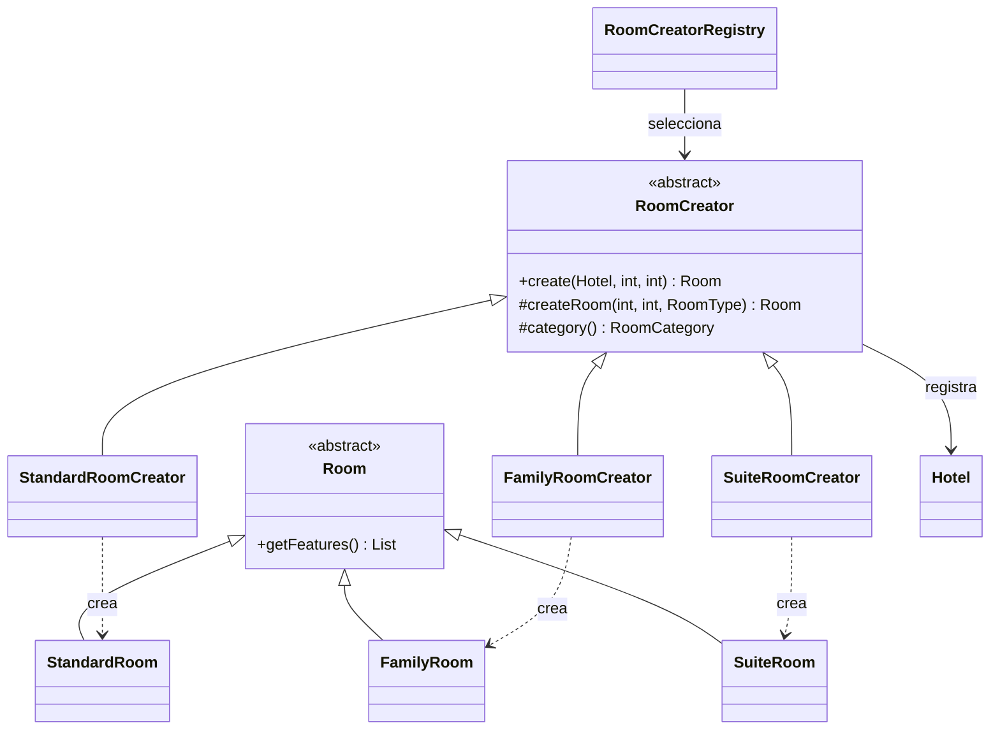

No se cuenta Registry como otro Factory Method, ni como Abstract Factory: no hay fábrica de familias de productos relacionados distintos.

### 2.3 Builder — creacional — implementado

**Problema:** crear una reserva con referencias/fechas/huéspedes/servicios/promoción opcionales, validando y calculando antes de producir el objeto. **Participantes:** clase interna Reservation.Builder y Reservation; BookingRecords.Quote es el valor copiado que construye.

**Evidencia:** [Reservation.Builder](../src/main/java/edu/hoteluq/model/Reservation.java#L139), métodos fluidos, `build`, validaciones, aritmética decimal y snapshot; constructor de Reservation privado. No es solo una cadena de setters sobre una reserva ya registrada.

**Pruebas:** ReservationTest.requiredReferencesDatesAndServicesFailWithDomainErrors, guestCountMustFitCapacity, nullStateDoesNotCorruptReservationAndBuilderCanBeReused; CommercialPolicyValidationTest para cálculos/total positivo. Hotel valida de nuevo al registrar.

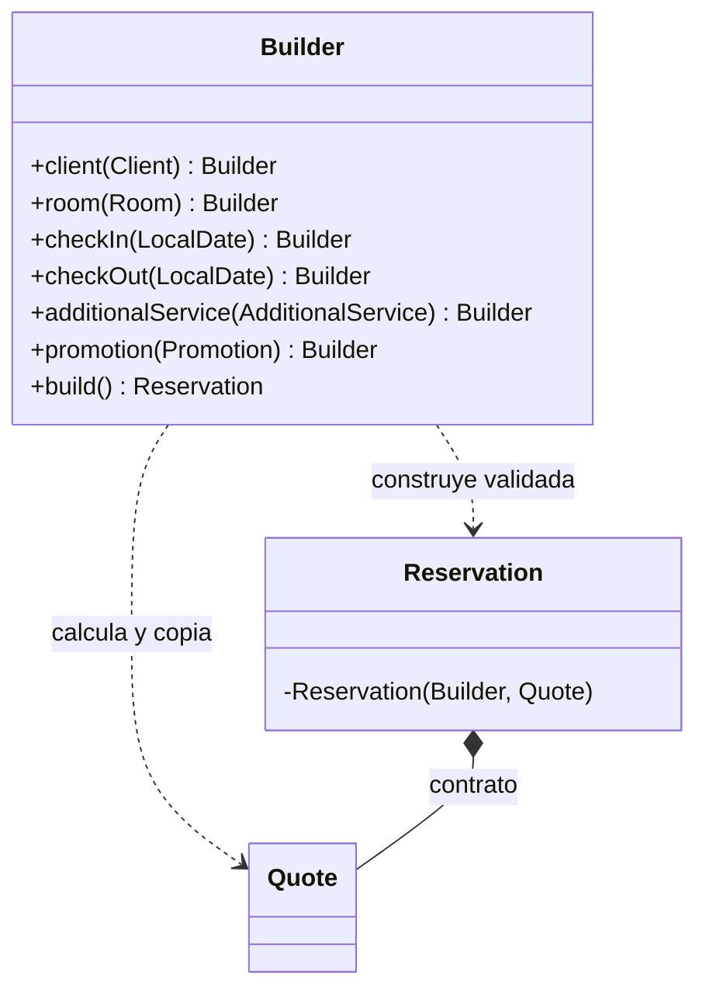

`Builder` en el dibujo corresponde a `Reservation.Builder`, no a una nueva clase propuesta.

### 2.4 Facade — estructural — implementado (una clase de patrón)

**Problema:** el llamador no debería coordinar scopes, resolución de entidades, autorización y resultados inmutables para cada caso de uso. **Participantes:** HotelService, ReservationService, Hotel, modelos y records de respuesta.

**Evidencia:** [HotelService](../src/main/java/edu/hoteluq/service/HotelService.java) agrupa identidad/catálogos/tarjetas; [ReservationService](../src/main/java/edu/hoteluq/service/ReservationService.java) expone reservas/checkout/configuración; ambas usan el mismo agregado e identidad y devuelven datos sin contraseñas/referencias mutables. Hay dos fachadas por alcance, **no dos patrones estructurales distintos**.

**Pruebas:** UserAuthorizationTest, CatalogAdministrationTest, BookingTransactionTest y Commercial3BTest las invocan sobre objetos reales con permisos y transacciones. No se afirma que sean controladores MVC.

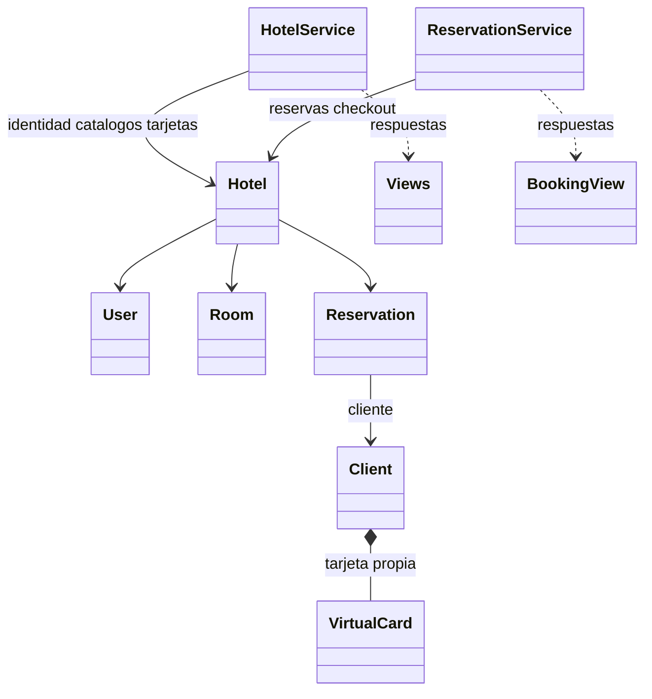

Las relaciones representan `Reservation.client` y `Client.card`; no se inventa una asociación directa Reservation→VirtualCard. Hotel coordina las operaciones monetarias.

### 2.5 State — comportamiento — implementado

**Problema:** una reserva no puede pagar/cancelar/finalizar desde cualquier estado. **Participantes:** ReservationState, PendingState, ConfirmedState, CancelledState, CompletedState, Reservation; Hotel coordina dinero y permisos.

**Evidencia:** [ReservationState](../src/main/java/edu/hoteluq/state/ReservationState.java) define el protocolo y errores para operaciones no admitidas; implementaciones delegadas por Reservation. Hotel llama a State dentro de `bookingAtomic`; las guardas bloquean transiciones directas de reservas registradas. No se realiza el débito dentro del State.

**Pruebas:** BookingTransactionTest confirma/cancela/finaliza; Commercial3BTest.checkoutRejectsUnauthenticatedOwnerPendingAndCancelled y cancelledAndCheckedOutReservationsCannotBeModified; RecoveryIntegrationTest.newStateEntrypointsRespectRegisteredEntityPermissions.

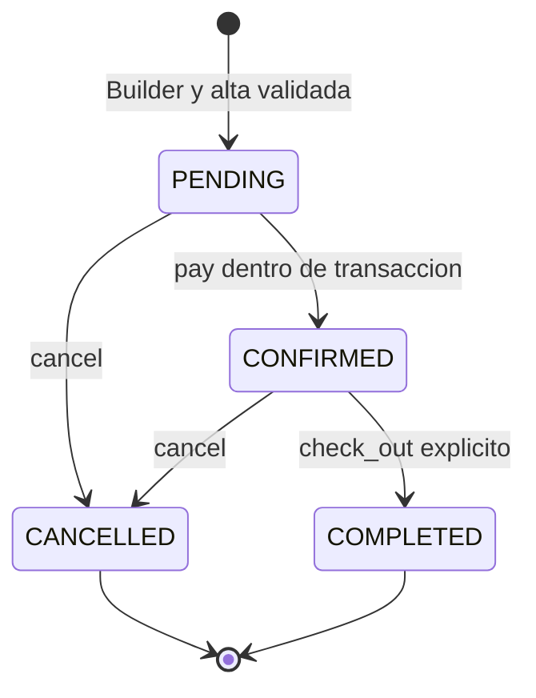

El diagrama resume las cuatro implementaciones reales del estado, no un temporizador. Idempotencia de comandos se decide en Hotel antes de volver a pedir transición; State no autoriza un segundo pago. Los objetos separados conservan armado legado; no pueden registrarse si no parten del PendingState original.

### 2.6 Strategy — comportamiento — implementado, perfil oficial validado (H-01 cerrado)

**Problema:** variar el cálculo de devolución sin colocar toda la fórmula en la reserva. **Participantes:** RefundPolicy y FullRefundPolicy/PartialRefundPolicy/NoRefundPolicy; CancellationSchedule.ConfiguredRefundPolicy, selección de ventana y Hotel.cancelReservation.

**Evidencia:** [RefundPolicy](../src/main/java/edu/hoteluq/strategy/RefundPolicy.java), implementaciones y [CancellationSchedule.select](../src/main/java/edu/hoteluq/strategy/CancellationSchedule.java#L69). La ruta del hotel usa Full; la del cliente usa Configured sobre un CancellationSchedule oficial activo por defecto y validado antes de activación/cálculo. El selector y el schedule comparten los mismos límites oficiales 24/72 h al 80 %. Los snapshots alternativos solo se admiten como datos históricos no activables.

**Pruebas:** RecoveryIntegrationTest.githubRefundBoundariesArePreserved, BookingTransactionTest.clientCancellationUsesDocumentedBoundaries y pruebas de configuración/versiones/fallos en Commercial3BTest. La corrección H-01 adaptó las expectativas incompatibles sin eliminar casos. OfficialCancellationTest aporta 30 casos nuevos de perfil oficial, límites, permisos, equivalencia, calendario y concurrencia. El mínimo de patrones no cambia al corregir la regla de negocio.

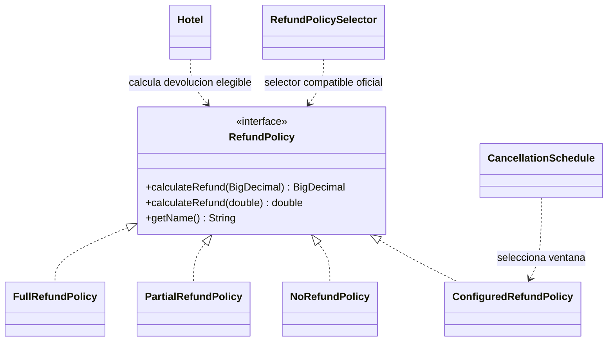

No se cuenta Strategy de promociones: Promotion contiene un porcentaje, sin condiciones/selector implementados.

## 3. Candidatos y etiquetas que no deben inflar la cantidad

| Candidato | Estructura observada / evidencia | Decisión conservadora |
|---|---|---|
| Template Method (comportamiento) | RoomCreator.create fija obtener tipo → createRoom hook → addRoom; category/createRoom varían por subclase. | El esqueleto es real y compatible con Template Method; puede justificarse como patrón solapado. No se certifica un tercero independiente solo por renombrar el recorrido Factory Method: documentar el problema de preservar el algoritmo y comprobar ese contrato para sustentación. Si docente lo admite, comportamiento podría sumar 3 sin nuevo código. |
| Protection Proxy (estructural) | ManagedEntity delega lectura/mutación a EntityGuard instalado por Hotel. | Hay protección real, pero no Proxy/RealSubject con contrato común en el modelo: es herencia y política de acceso embebida. No dibujar envoltorios inexistentes ni sustituir las guardas para ganar un punto. |
| Adapter (estructural) | Sobrecargas double→BigDecimal conservan compatibilidad. | Una conversión/overload no demuestra por sí sola el problema de adaptar contratos de componentes. No se cuenta sin Target/Adaptee justificados. |
| Observer (comportamiento) | AuditEvent es un record; transactionProbe es Consumer para inyectar fallos en tests. | No hay Subject con suscripción/notificación ni receptor de notificaciones del cliente. No cuenta como RF-026 implementado. |
| Composite / Decorator | Listas de servicios, suma en Builder y promoción porcentual. | No hay componente común compuesto recursivo ni envoltorio de cálculo con contrato común; sumar una lista no es Composite/Decorator. |
| Abstract Factory | Registry devuelve RoomCreator. | No hay múltiples productos relacionados de una familia. No se cuenta adicionalmente al Factory Method. |

Diagrama del candidato Template Method, con clases existentes:

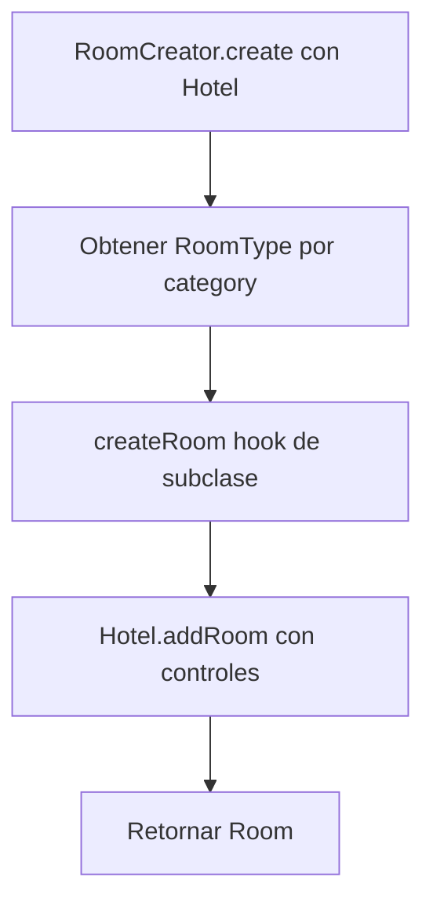

Este dibujo acredita el esqueleto observado, no agrega un patrón nuevo por decisión administrativa de la auditoría.

## 4. Patrones faltantes: propuestas ligadas a necesidades reales

**Todo lo siguiente es diseño propuesto, sin clases implementadas.** La aplicación debe conservar su atomicidad, COP, permisos y snapshots; no se necesita una clase vacía por cada nombre de patrón.

| Patrón / categoría | Necesidad real y responsabilidad | Participantes propuestos (no presentes) | Evidencia futura exigida |
|---|---|---|---|
| Composite / estructural — IMPLEMENTADO H-02 | El programa debe redimir paquetes de servicios (§4). Representar paquete y servicio con un contrato común, permitiendo precio/disponibilidad agregados. | ServiceComponent, SingleServiceComponent, ServicePackage; colección de componentes. | Precio/disponibilidad recursivos; composición válida, ciclos rechazados y canje real del paquete. |
| Decorator / estructural | Extender una cotización base con servicios/beneficios sin hacer crecer condicionales del Builder. No sustituir condiciones de promoción por descuentos sin elegibilidad. | ChargeComponent, RoomCharge, AdditionalServiceCharge, BenefitCharge si la regla del grupo lo permite. | Mismo contrato raw quote, suma ordenada y snapshot explicable, sin servicio duplicado ni redondeos acumulativos. |
| Adapter / estructural | Los reportes deben servir a negocio y gráficos JavaFX sin introducir Series/Data JavaFX en el dominio. Adaptar un resultado inmutable a contratos de presentación del framework. | ReportResult como origen, ChartModelAdapter/ChartDataPort y adaptadores para barras/líneas/pastel necesarios. | Igual periodo/totales entre archivo y gráfico; adaptación probada con dataset vacío, ejes/etiquetas correctos y ninguna dependencia JavaFX en cálculo de negocio. |
| Observer / comportamiento | RF-026 propio: varias vistas/bandeja/puntos necesitan reaccionar a operaciones confirmadas. Eventos posteriores al commit evitan avisos de pagos revertidos. | DomainEventPublisher, DomainEventListener, NotificationInboxListener; emisión una vez tras commit. | Cero notificación en rollback, varias suscripciones reales y manejo idempotente de reintentos. No hacer que una excepción de notificación deje un cobro a medias. |

Diagramas propuestos, **sin atribuirlos al código actual**:

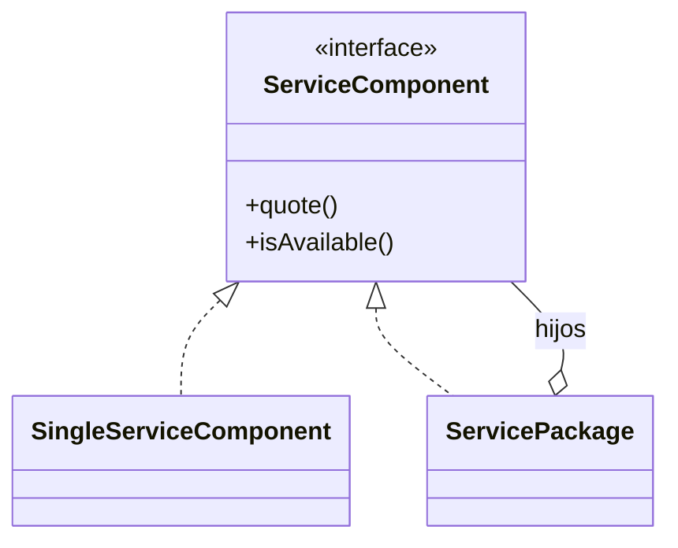

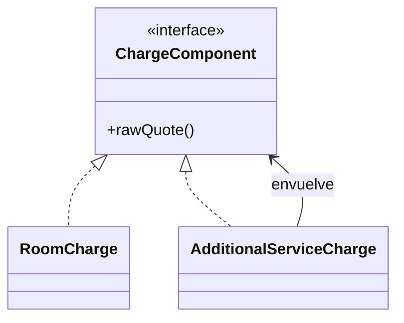

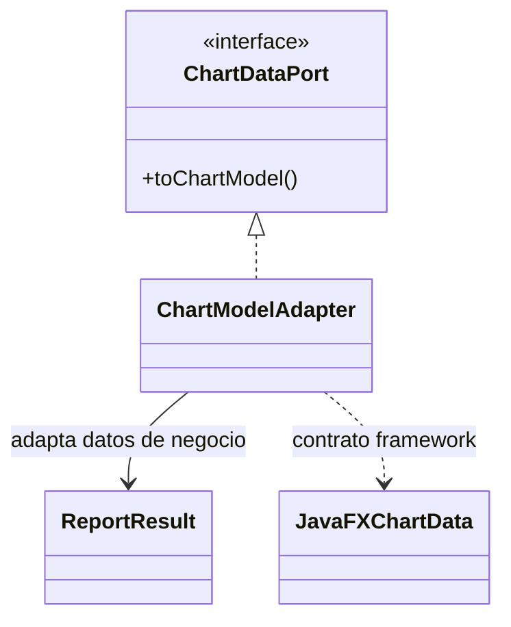

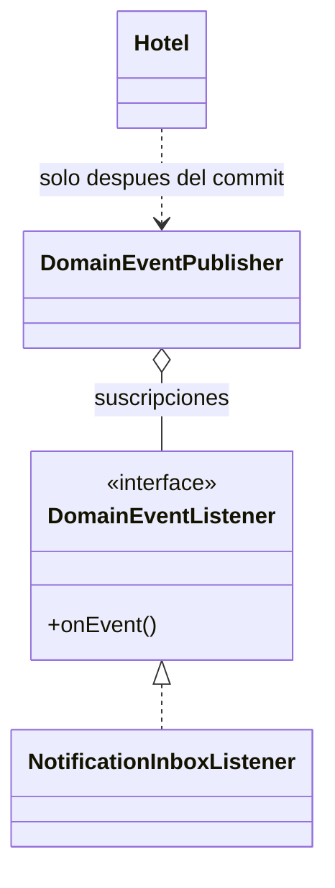

Composite ya está implementado en H-02. Decorator está implementado en H-03 mediante PriceComponent; Adapter sigue propuesto para una necesidad real de reportes/UI. Observer aportaría un tercer comportamiento inequívoco sin depender del debate de Template Method. No se recomienda implementar un motor de persistencia únicamente para justificar Adapter/Repository: persistencia requiere autorización separada y no es mínimo literal del PDF.

## 5. Defensa verificable y diagrama final

Para cada patrón, el estudiante debe localizar el punto de variación, recorrer una llamada y un test real, explicar una alternativa razonable y el costo del patrón. No afirmar que una clase llamada Factory o Policy acredita cantidades sin mostrar su uso. Todas las personas deben poder defender todas las categorías, porque el docente selecciona quién sustenta el sistema completo.

El diagrama PDF final debe representar las clases reales del producto entregado, sus interfaces/enums, herencias, composiciones/agregaciones, multiplicidades y responsabilidades; diferenciar modelos implementados de los propuestos. Los Mermaid de este informe aportan evidencia de auditoría, pero no existen todavía como ese artefacto PDF del proyecto. La selección de patrones nuevos y cualquier refactorización quedan fuera de esta ejecución.

## 6. Actualización H-02: Composite y separación de responsabilidades

**Composite — estructural — implementado.** Problema: paquetes anidados deben compartir cálculo de precio, disponibilidad y servicios con una hoja, evitando listas especiales y descuentos ficticios. Participantes reales: `ServiceComponent` (contrato sellado), `ServiceComponent.Leaf` (AdditionalService) y `ServiceComponent.Package` (lista inmutable de componentes); `LoyaltyCatalog` valida referencias y ofrece snapshots. `Hotel` coordina la autorización; `Reservation.applyPointsBenefit` incorpora las hojas del paquete sin duplicar servicios y conserva contrato/bonificación.

Evidencia: `LoyaltyIntegrationTest.nestedPackageIsCompositeAndRoundsOnce` crea dos niveles, verifica suma 0,4+0,4→1 COP y canje real con dos servicios; `packageRejectsDuplicatesInvalidReferencesAndEmptyContents` verifica errores y protección de eliminación. Los ciclos se impiden por construcción: solo referencias a paquetes ya registrados e inmutables, sin actualización de hijos; no se afirma haber probado un setter cíclico inexistente.

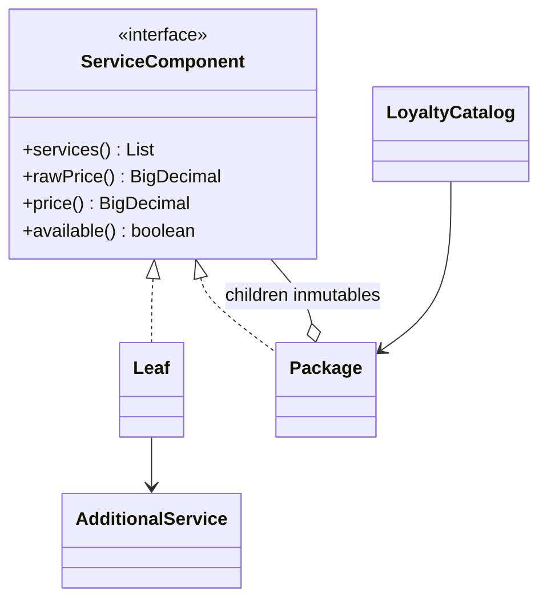

**SOLID:** mejora SRP al separar libro contable (`PointsLedger`), configuración (`LoyaltyPolicy`), equivalencia (`Benefit`), paquetes (`LoyaltyCatalog`/Composite) y fachada (`LoyaltyService`). El agregado conserva un único monitor/checkpoint para no romper atomicidad. OCP/LSP/ISP tienen ejemplo adicional en Leaf/Package: el cliente usa las mismas operaciones de composición sin depender de un subtipo concreto; no se añaden métodos de modificación inútiles a hojas. El catálogo usa una Function de resolución de servicios registrada; no demuestra por sí sola una inversión global de arquitectura. DIP y la concentración previa de Hotel siguen parciales; no se certifica el conjunto SOLID por añadir interfaces.

Acumulación/reversión se configuran por valores versionados explícitos. No se cuentan enums de opciones ni records como nuevas Strategy/Factory ni el ledger como Observer. State/Strategy existentes no se sustituyen. La fachada nueva sigue siendo el mismo patrón Facade, no otro estructural distinto.

Conteo actual: **3 creacionales / 2 estructurales / 2 comportamientos**; faltan 2 estructurales y 1 comportamiento para el mínimo 3/4/3. Las propuestas anteriores siguen siendo propuestas excepto Composite; quedan pendientes diagramas de entrega PDF y defensa de límites SOLID. Configuración, negocio y pruebas: programa-puntos-h02.md / evidencia-h02.txt.

## 7. Actualización H-03: Specification y Decorator

### Specification — patrón de dominio — implementado

**Problema:** las promociones requieren comprobar simultáneamente fechas, categoría, noches, frecuencia, servicios y paquetes sin meter cada regla dentro del agregado ni aceptar un booleano de elegibilidad del solicitante.

**Participantes reales:** `PromotionCondition` con `satisfiedBy(Context)` y `and`; `StayWindow`, `RoomTypes`, `MinimumNights`, `FrequentClient`, `Services`, `Packages`; `All` evalúa una conjunción por polimorfismo. `PromotionDefinition.requireEligible` valida actividad/instantes y usa esa conjunción. Hotel construye el contexto de hechos reales bajo su monitor; no acepta un Context enviado para aplicar una promoción. Las implementaciones selladas evitan configurar predicados externos arbitrarios que siempre retornen true.

**Evidencia:** `PromotionRulesTest.allOfComposesSpecificationsWithoutChangingPredicates`, límites de noches/fecha/frecuencia y conjuntos; `PromotionIntegrationTest` prueba elegibilidad real, propietarios, referencias, cambios PENDING y revalidación antes del cargo. Las condiciones no conceden automáticamente servicios ni sustituyen el pago.

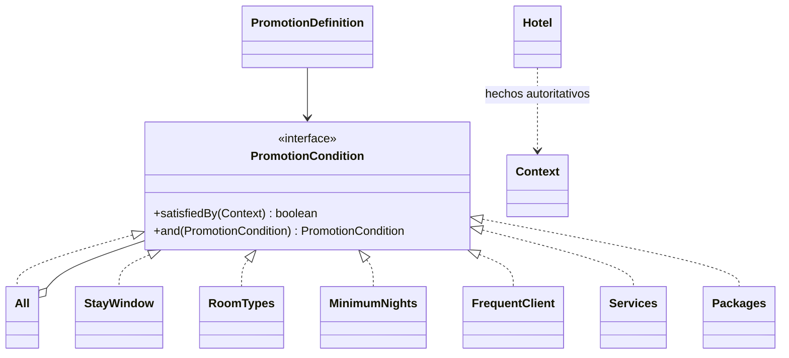

Specification no forma parte del catálogo original de 23 GoF. Se documenta como patrón de dominio de elegibilidad; no se da por satisfecho el tercer comportamiento académico sin comprobar el criterio de la rúbrica. La composición de predicados aquí no se suma otra vez como otro Composite: el patrón estructural Composite ya se cuenta una vez por paquetes H-02.

### Decorator — estructural — implementado

**Problema:** aplicar porcentaje y beneficio por puntos en un orden comercial explícito, conservando precisión hasta el cobro y sin duplicar fórmulas o condicionales de cada componente en Hotel.

**Participantes reales:** `PriceComponent.amount()` es el contrato; `Base` produce subtotal crudo; `Percent` y `Fixed` envuelven un PriceComponent e implementan el mismo contrato. `PriceComponent.net` ensambla `Fixed(Percent(Base))` o `Percent(Fixed(Base))` según la configuración. `Reservation.Builder` usa Percent para promociones y `applyPointsBenefit` compone los componentes autorizados. `CopMoney.positive` aplica la frontera final COP/total positivo.

**Evidencia:** `PromotionRulesTest.explicitDecoratorOrderAffectsCash` prueba 160 frente a 162 para los dos órdenes explícitos de fixture; `roundingHappensOnlyOnFinalObligation` comprueba precisión intermedia. `PromotionIntegrationTest.configuredPointCombinationsAreAtomicAndRefundOriginalPayment` paga con cada orden, acumula sobre efectivo, reintenta y devuelve el pago original. Hay pruebas de servicio/paquete bonificado y de combinación exclusiva rechazada sin efectos.

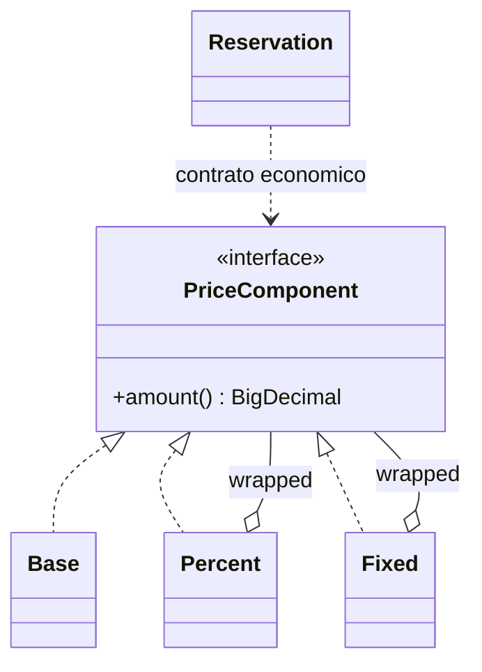

**SOLID:** SRP separa reglas, versiones/auditoría, fachada y fórmula; Hotel conserva coordinación transaccional/identidad y sigue siendo un agregado grande. OCP/LSP/ISP se evidencian en el contrato único de importe crudo y los predicados sustituibles, sin métodos de mutación inútiles. Los contratos sellados tienen un coste de extensión intencional: para otra familia validada hay que ampliar el whitelist y sus validaciones de referencias. DIP permanece parcial por el acoplamiento de fachadas a Hotel concreto y por dependencias de capas heredadas. No se certifica cumplimiento global de SOLID.

**Inventario actual conservador:** 3 creacionales (Singleton, Factory Method, Builder), 3 estructurales (Facade, Composite, Decorator), 2 comportamientos GoF (State, Strategy), más Specification de dominio. Falta un estructural real y un comportamiento GoF inequívoco para el mínimo 3/4/3; Adapter/Observer siguen propuestas para necesidades futuras, sin clases vacías. State/Strategy y Composite no se reemplazan ni se cuentan de nuevo por sus implementaciones.

Contrato y decisiones: [promociones-h03.md](promociones-h03.md). Evidencia: [evidencia-h03.txt](evidencia-h03.txt). Los diagramas Mermaid complementan la auditoría; no sustituyen el PDF de clases final exigido por el docente.

## 8. H-04 — Separación MVC y evidencia gráfica

Main lanza HotelApplication; FXML/CSS y los componentes Ui conforman vistas reales. ShellController/LoginController y las clases de pantalla gestionan eventos/navegación; DesktopController mantiene estado de sesión y gate de envío, comprobable sin toolkit. FxActions serializa comandos de fondo y devuelve resultados al hilo JavaFX. Las reglas permanecen en HotelService/ReservationService/LoyaltyService/PromotionService y sus entidades/colaboradores.

No hay fórmula de descuentos, reembolsos, saldos ni puntos en controladores. Las nuevas consultas de cotización y devolución reutilizan cálculos de dominio; la UI presenta DTOs y solicita aceptación. Estado/versiones se revalidan en servicios, no solamente al habilitar botones. La conversión decimal/formato no constituye otro patrón económico ni Adapter GoF por sí sola.

Las vistas extensas se construyen programáticamente con sus handlers en las clases de pantalla; FXML se usa para shell/acceso. Es MVC funcional con un límite claro frente al modelo, aunque separar más composición de vistas/controladores sigue siendo mejora SRP. Hotel conserva la frontera única de bloqueo y sigue concentrando coordinación: SOLID global permanece parcial. No se certifica DIP solo por inyectar un Hotel concreto.

State/Strategy, Composite, Decorator y Specification se conservan. MVC es un patrón arquitectónico y no se cuenta como un nuevo GoF para alcanzar 3/4/3. No se introducen patrones artificiales ni diagramas finales. Guía: ejecucion-javafx-h04.md; pruebas/capturas: evidencia-h04.txt.

## 9. H-05 — Adapter real para reportes y JavaFX

**Problema:** el servicio de reportes debe calcular y exportar sin depender de toolkit. Sus series tipadas e inmutables (ChartSpec/Series/Point, con BigDecimal) no son utilizables directamente por BarChart/LineChart/PieChart, que requieren ObservableList, XYChart.Series/Data o PieChart.Data y reglas de presentación distintas.

**Participantes comprobables:** Target `ReportChartView.render(ChartSpec, Type)` devuelve un Node; cliente `ReportScreen` depende de ese puerto; adaptee `ReportResult.ChartSpec` viene del modelo sin imports JavaFX; object Adapter `ReportChartAdapter` construye los contratos requeridos por cada gráfico. No suma ni recalcula importes de negocio. El pastel rechaza varias series o valores negativos en lugar de fabricar valores absolutos/sectores.

**Evidencia:** ReportsJavaFxTest genera las ocho familias con registros reales y cambia barras/pastel/líneas, comprueba tablas y produce capturas. También prueba rechazo de pastel negativo y aceptación de barras con neto negativo. ReportEngineTest y ReportIntegrationTest prueban que agregados y TXT conservan valores exactos independientemente del toolkit.

ReportExporter es un contrato de formato, implementado por TxtReportExporter; futuro PDF puede consumir el mismo resultado sin cambiar consultas. No se cuenta esa interfaz como otro patrón por sí sola. ReportService es otra fachada por alcance, no otro Facade distinto.

**SOLID:** SRP separa snapshot/consulta, agregación, asignación COP, proyección de puntos, formato/escritura y visualización. DIP mejora en la presentación con el puerto ReportChartView, aunque el acoplamiento global a Hotel concreto sigue parcial. OCP permite añadir formato sin modificar fórmulas; ReportEngine todavía selecciona familias por enum/switch y tiene varios métodos de agregación, una limitación reconocida. LSP/ISP tienen un contrato de chart y de exporter pequeño; la corrección de negocio se verifica aparte, no se infiere de tener interfaces.

Inventario conservador actual: Singleton, Factory Method, Builder (3 creacionales); Facade, Composite, Decorator, Adapter (4 estructurales); State/Strategy (2 comportamientos GoF), más Specification de dominio. Falta el tercer comportamiento GoF inequívoco/aceptación de criterio en la rúbrica; no se introducen patrones artificiales. No se hicieron diagramas finales en H-05. Las referencias históricas a Adapter como propuesta quedan cerradas por esta implementación y su evidencia.
