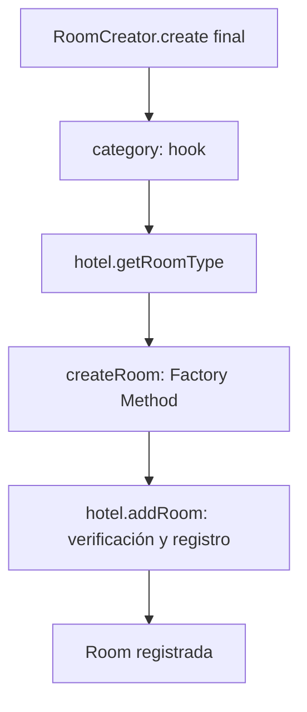

# Revisión focalizada de patrones — HotelUQ

Base revisada: ZIP `HotelUQ-Final.zip` proporcionado por el equipo; no equivale a revisión automática de commits posteriores en GitHub.

## Recuento observado

| Categoría GoF | Exigidos | Encontrados en el código | Evidencia |
|---|---:|---|---|
| Creacionales | 3 | Singleton, Factory Method, Builder | `Hotel`, `RoomCreator`/creadores, `Reservation.Builder` |
| Estructurales | 4 | Facade, Composite, Decorator, Adapter | `HotelService`/`ReservationService`, `ServiceComponent`, `PriceComponent`, `ReportChartAdapter` |
| Comportamiento | 3 | State, Strategy; Template Method identificable en la fábrica de habitaciones | `ReservationState`, `RefundPolicy`, `RoomCreator.create(Hotel,int,int)` |

## Tercer comportamiento: Template Method

**Necesidad distinta de Factory Method.** El hotel necesita imponer el orden obligatorio de creación de una habitación: (1) buscar el `RoomType` registrado, (2) construir la subclase mediante un hook, (3) registrar la instancia bajo las validaciones de `Hotel.addRoom`. Si cada creador controlara este procedimiento, podría saltarse los controles de alta.

**Participantes:** `RoomCreator.create(Hotel,int,int)` es el método plantilla (ahora `final`); `category()` y `createRoom(...)` son puntos de variación; `StandardRoomCreator`, `FamilyRoomCreator` y `SuiteRoomCreator` implementan los hooks. `RoomCreator.createRoom` es también Factory Method: ambos patrones pueden compartir clases, aunque su valor didáctico y su aceptación como dos patrones separados deben defenderse ante el docente.

**Nueva prueba añadida:** `HotelTest.templateMethodResolvesCategoryThenCreatesAndRegistersRoom` verifica orden de hooks, registro y rechazo de números duplicados. La prueba no se ha ejecutado en este entorno; debe correrse en Ubuntu con la distribución Gradle y JDK 21 del equipo.

### Limitación académica

Template Method está implementado como estructura de algoritmo en la misma jerarquía que Factory Method. Si la rúbrica exige **tres patrones de comportamiento independientes** y no admite esta doble responsabilidad, habrá que incorporar otro patrón inequívoco (por ejemplo Observer en notificaciones posteriores a operaciones confirmadas), con integración real y pruebas. No declarar aceptación del docente sin confirmarla.

## Hallazgos adicionales

- SOLID se acredita por ejemplos puntuales, no como certificado de cumplimiento global: `Hotel` conserva varias responsabilidades.
- `Specification` es una composición de predicados de negocio, no se cuenta automáticamente entre los comportamientos GoF exigidos.
- La persistencia es volátil: no anunciar la aplicación como durable.
- El mínimo académico de pruebas debe verificarse con `./gradlew --no-daemon clean test build fxTest` en el equipo Linux con JavaFX disponible.

## Estado de la intervención

Se modificó **solo** `RoomCreator.java`, una clase de prueba (`HotelTest.java`) y este documento. No se tocó State/Strategy ni el mecanismo de pagos, cancelaciones, puntos o promociones. No hay commits, push ni cambios al repositorio remoto.
